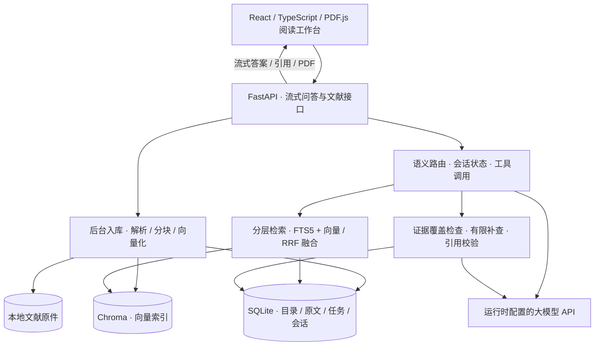

# NexusMind · 智能文献知识库

NexusMind 是一个面向文献阅读与研究的 AI 知识库。用户可以管理 PDF 文献，通过连续问答理解论文、比较研究方法，并点击回答中的引用，在右侧 PDF 预览中定位对应的原文片段。

项目采用 React 阅读工作台与 FastAPI 后端，本地保存原文、索引和会话，通过运行时配置的模型 API 完成问题理解、工具调用与回答生成。

## 项目功能

- **文献管理**：上传、文件夹管理、搜索与元数据编辑；后台执行解析和索引，展示入库状态，支持失败重试。
- **分层问答**：区分目录查询、文件状态、全文概览、局部证据问答与通用聊天。目录问题读取真实记录，内容问题按文献范围取证。
- **连续阅读**：持久化保存会话，结合近期对话、相关历史与当前讨论对象，处理“这篇论文”“第二个阶段”等追问。
- **跨文献比较**：围绕问题指定的维度，分别检索多篇论文的证据，检查覆盖情况并在预算内补查。
- **引用回溯**：答案中的引用关联文献版本、原文片段、页码和坐标。点击后在右侧阅读原文并高亮，左侧可继续咨询。
- **阅读辅助**：文献章节与论文卡片、PDF 高亮和下划线标注；提供显式的联网找论文入口。
- **通用问答**：可关闭知识库检索直接咨询模型，通用回答与文献依据分开呈现。

项目主要面向可提取文本的 PDF。扫描件与复杂版式的解析效果需要单独验证；当前没有接入聊天图片输入。引用的语义支持包含模型判断，重要结论应结合原文核对。

## 技术架构

当前实现为 **前后端分离、后端模块化单体、单进程本地存储**。问答使用自建的语义路由与 Function Calling 工作流。架构文档中的 LangGraph 属于早期规划，不是当前运行依赖。



### 前端

React 18、TypeScript、Vite、Tailwind CSS 和 Ant Design 构建问答与文献管理界面；React Markdown 渲染答案，PDF.js 提供原文预览和证据高亮。

### 后端与检索

FastAPI 提供 HTTP 接口，通过 NDJSON 传输流式答案。SQLite 保存文献、入库任务、规范化片段、会话和标注，FTS5 提供全文检索。FastEmbed 在本地使用 `BAAI/bge-small-zh-v1.5` 生成向量，Chroma 承担向量召回；混合检索使用 RRF 融合排名。向量分数用于排序，不代表答案正确率。

全文概览按批次阅读已解析正文，超出上下文预算时递归汇总并保留来源。局部问题可调用论文列表、论文搜索、卡片、章节和片段读取等工具，再按问题维度提取和核验原文证据。

### 模型与数据边界

默认主模型接入 DeepSeek。主模型用于问题路由、工具规划、论文卡片、证据检查和引用核验。页面上的回答模型选择可接入其他已配置的提供方或 Ollama，它只切换最终回答模型，不会替换全部后台模型调用。

原始文件、数据库与索引保存在本地；调用云端模型时，相关问题、历史和文献内容会发送给模型服务。联网找论文及元数据补全也会访问外部服务。

## 安装与运行

以下命令从仓库根目录执行，Windows PowerShell 示例可以直接使用。

### 1. 环境准备

- Python 3.12，建议使用独立虚拟环境。
- Node.js 22.12 或更高版本与 npm。当前 Vite 依赖要求 Node `^20.19.0 || >=22.12.0`。
- 可用的模型 API Key，以及该账户可调用的模型名称。
- 首次安装依赖、下载本地嵌入模型及调用云端服务需要网络。

```powershell
git clone https://github.com/rsyyyyyyy/rag-knowledge-base.git
cd rag-knowledge-base
python -m venv backend/venv
./backend/venv/Scripts/python.exe -m pip install --upgrade pip
./backend/venv/Scripts/python.exe -m pip install -r backend/requirements.txt
cd frontend
npm ci
cd ..
```

Linux / macOS 创建环境和安装后端依赖时，将 `./backend/venv/Scripts/python.exe` 替换为 `./backend/venv/bin/python`，通常使用 `python3 -m venv backend/venv` 创建环境。

### 2. 启动后端并输入 API Key

推荐使用交互输入。未设置 `DEEPSEEK_API_KEY` 时，程序会提示隐藏输入密钥，输入后回车；密钥不写入项目文件，也不返回给浏览器。

```powershell
./backend/venv/Scripts/python.exe backend/run.py
```

如果账户使用其他模型名称，请在启动时指定：

```powershell
./backend/venv/Scripts/python.exe backend/run.py --model <账户可用的模型名称>
```

`<账户可用的模型名称>` 是需要替换的说明文字。默认名称沿用项目现有的 `deepseek-flash`，是否可用取决于实际账户和服务端；遇到模型不存在错误时，请传入可用名称。

也支持完整命令行参数：

```powershell
./backend/venv/Scripts/python.exe backend/run.py --api-key YOUR_API_KEY --model YOUR_MODEL_NAME --base-url https://api.deepseek.com --port 8001
```

`YOUR_API_KEY`、`YOUR_MODEL_NAME` 均为占位符。命令行参数可能进入终端历史，日常使用优先选择隐藏输入。程序不会自动读取 `.env`，无需创建含密钥的源码或配置文件。

配置优先级为 **显式启动参数 → 当前进程环境变量 → 默认值**；API Key 没有默认值，缺失时交互输入。无交互终端时缺少密钥会报错退出。

支持的参数：

- `--api-key`：模型密钥，对应 `DEEPSEEK_API_KEY`。
- `--model`：主模型名称，对应 `DEEPSEEK_MODEL`。
- `--base-url`：主模型接口地址，对应 `DEEPSEEK_BASE_URL`，默认 `https://api.deepseek.com`。
- `--host`：监听地址，默认 `127.0.0.1`。
- `--port`：后端端口，默认 `8001`。
- `--data-dir`：本地数据目录，对应 `RAG_DATA_DIR`，默认 `backend/data`。

接口地址和模型名称会同时应用到回答与后台路由、核验流程。自定义服务需要兼容 OpenAI Chat Completions、JSON 输出、工具调用，以及项目现有的 DeepSeek 请求扩展；仅修改地址不保证兼容所有提供方。

原来的 `python backend/app.py` 入口也会转入同一启动流程。后端启动后，可打开 [交互式 API 文档](http://127.0.0.1:8001/docs)。默认本机单进程运行，不要对同一份 Chroma 数据启动多个后端进程或配置多个 worker。

### 3. 启动前端

保持后端终端运行，另开一个终端，在仓库根目录执行：

```powershell
cd frontend
npm run dev -- --host 127.0.0.1 --port 5173
```

访问终端提示的地址，通常是 [http://127.0.0.1:5173](http://127.0.0.1:5173)。端口被占用时 Vite 可能选择其他端口。

开发模式通过 `/api` 代理访问 `http://127.0.0.1:8001`。如果后端改用 8003，先在前端终端设置代理目标：

```powershell
$env:VITE_DEV_API_TARGET = "http://127.0.0.1:8003"
npm run dev -- --host 127.0.0.1 --port 5173
```

模型密钥只在后端配置，不要放进 `VITE_` 环境变量。

### 4. 首次使用

1. 在“知识库管理”上传自己的 PDF，单文件上限为 20 MiB。
2. 等待入库状态变为“可检索”。首次向量化可能需要下载嵌入模型。
3. 切换“智能问答”，确认知识库检索开启，输入 `当前知识库有哪些文献？`。
4. 输入一个真实文件名，再问 `这篇论文解决了什么问题？` 或 `请解释它的核心方法，并引用原文。`。
5. 回答及引用核验完成后点击引用编号，在右侧核对原文；继续使用“这篇”“第二个阶段”等方式追问。

新克隆的仓库不包含个人知识库和聊天记录。演示脚本中的论文名称仅在你上传相应文献后可用。

### 5. 数据目录与其他配置

应用数据默认位于 `backend/data`，包含文献原件、数据库和入库状态，该目录已由 Git 忽略。Windows 中文路径下，Chroma 索引可能自动存放到同盘的 `rag-kb-chroma-<摘要>` 英文目录，具体位置以启动日志为准。可通过 `RAG_CHROMA_DIR` 指定可写的英文路径。

```powershell
$env:RAG_CHROMA_DIR = "F:/rag-kb-data/chroma"
./backend/venv/Scripts/python.exe backend/run.py --data-dir F:/rag-kb-data/library
```

`--data-dir` 改变后会使用对应目录的数据，不会自动迁移旧库。备份应包含应用数据和实际 Chroma 目录。

其他可选环境变量：

- `RAG_AUTO_PROFILE=0`：关闭自动论文卡片生成，减少后台模型调用。
- `RAG_AUTO_METADATA=0`：关闭启动时自动元数据补全。
- `OLLAMA_BASE_URL`、`OLLAMA_MODEL`：配置本地回答模型；主工作流仍需要主模型 API。
- `DASHSCOPE_API_KEY`、`QWEN_MODEL`：配置通义千问回答模型。
- `OPENAI_API_KEY`、`OPENAI_MODEL`、`OPENAI_BASE_URL`：配置 OpenAI 兼容回答模型。
- `MOONSHOT_API_KEY`、`MOONSHOT_MODEL`：配置 Moonshot 回答模型。
- `CUSTOM_LLM_BASE_URL`、`CUSTOM_LLM_MODEL`、`CUSTOM_LLM_API_KEY`：配置自定义回答模型。

环境变量需在对应服务启动前设置，修改主模型配置后重启后端。后台卡片、全文阅读与引用核验也会调用模型，实际用量不只来自最终回答。

### 6. 构建与验证

前端构建：

```powershell
cd frontend
npm run build
cd ..
```

构建结果位于 `frontend/dist`。部署前可通过 `VITE_API_BASE_URL` 设置浏览器访问的后端地址（包含 `/api`）；该变量在构建时生效。当前默认配置用于本地工作区，面向公网部署还需完善鉴权、来源限制与反向代理。

运行启动配置测试：

```powershell
$env:PYTHONPATH = "backend"
./backend/venv/Scripts/python.exe -m unittest discover -s backend/tests -p test_runtime_config.py -v
```

## 常见问题

**无法访问后端或提示 Failed to fetch**：确认后端没有退出，前端代理端口与后端端口一致；打开 `/docs` 检查连通性。

**API 密钥无效、余额不足或模型不存在**：检查本次输入的密钥、服务商地址和 `--model`；修改后重启。程序不会验证密钥归属，服务端调用结果才是有效性依据。

**有文件记录但暂时无法问答**：检查是否达到“可检索”状态，以及当前会话的文件夹或文献范围是否包含该文件。

**首次入库慢或下载失败**：本地嵌入模型首次使用需要下载；检查网络、磁盘空间和模型缓存。纯扫描 PDF 不能仅凭文件上传成功就保证可提取正文。

**全文概览等待较长**：长论文会逐批阅读和核验来源，可以先问一个具体章节或方法问题。录制演示可参考 [视频演讲稿](docs/demo-video-script.md)。

## 团队信息

- 项目名称：NexusMind 智能文献知识库。
- 参赛赛道：AI WEB网页开发挑战赛。
- 团队名称：知识就是力量。
- 所属学校：西安交通大学。
- 组长：任思羽。
- 组员：李晨洁。
- 仓库维护账号：[rsyyyyyyy](https://github.com/rsyyyyyyy)。
- 项目交流：通过 [GitHub Issues](https://github.com/rsyyyyyyy/rag-knowledge-base/issues) 提交问题与建议。
