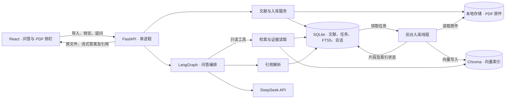

# 文献知识库整体架构

v0.1 · 首版架构 · 2026 年 11 月 16 日

需求依据为[《文献知识库需求分析》v0.1](literature-knowledge-base-requirements.md)。主参考为 [RAGFlow v1.0.0，提交 db1cd59](https://github.com/infiniflow/ragflow/tree/db1cd5929a7885a3074547791f5ecc4d2f891739)。

## 1 架构决策

首版采用 **React 阅读工作台 + FastAPI 模块化单体 + 单后台入库线程**。部署假设为个人本地工作区。FastAPI 以单进程运行，持有唯一的本地 Chroma 客户端。入库任务落盘，由同一进程内的后台线程消费。PDF 解析、分块和向量化离开请求处理线程。后端重启后从数据库恢复未完成的任务。本机 Python 3.12 已验证可用 SQLite FTS5。[Chroma 嵌入式部署约束](https://cookbook.chromadb.dev/core/system_constraints/) · [SQLite FTS5](https://sqlite.org/fts5.html)

RAGFlow 是模块和数据流的主参考。我们沿用它的入库与在线问答分离、先搜索再读原文、会话与单次运行状态分离、以片段坐标驱动 PDF 引用的边界。首版以 SQLite 支撑本地任务和业务状态，用 LangGraph 在问答模块内编排单 Agent，通过现有 DeepSeek 客户端调用模型。[RAGFlow 入库执行器](https://github.com/infiniflow/ragflow/blob/v1.0.0/internal/ingestion/task/pipeline_executor.go) · [RAGFlow Agent 主循环](https://github.com/infiniflow/ragflow/blob/v1.0.0/internal/agentic_rag/agent.go) · [LangGraph 检索 Agent](https://docs.langchain.com/oss/python/langgraph/agentic-rag)

## 2 模块职责

- **文献与任务**（FR-01、FR-02）。管理文献、版本、标签、专题和上传任务。文件校验、登记和入队后立即返回任务 ID，页面轮询状态，失败文献可单独重试。
- **检索与原文**（FR-02、FR-04）。先按实际生效的文献范围取候选，再并行查 FTS5 和 Chroma，融合结果。读取工具按稳定 ID 返回原文和相邻片段。
- **问答编排**（FR-03 至 FR-05、FR-07）。解析模式和范围，调用 DeepSeek 筛证据、决定补查或澄清、生成回答。会话模块提供上一轮的文献对象和引用。
- **引用与阅读**（FR-06）。验证模型引用 ID，返回该版本 PDF 的页码和高亮坐标。React 中的问答区与阅读区各自滚动，沿用现有右侧栏布局。
- **存储与模型适配**。统一文件路径、数据库事务、索引接口和 DeepSeek 请求。模块通过这些接口访问外部依赖，App 入口负责组装依赖和注册路由。

## 3 数据归属与引用契约

**本地文件**保存原 PDF，以 SHA-256 做文件去重。**应用 SQLite**保存书目信息、专题、文献版本、索引任务、规范化原文片段、页码坐标、会话和引用记录。FTS5 与片段同库。**Chroma**只承担向量召回，存储片段标识、索引代次和检索所需元数据，索引可从本地数据重建。

- **文献与版本**。文献是书目实体，版本是可打开的原文件快照。预印本与正式版可关联到同一文献，引用保持指向实际使用的版本。标题、标签等更正与原文件版本的身份独立。
- **片段**。片段有 `chunk_id`、`document_id`、`version_id`、`index_generation_id`、`page_index`、章节、正文和页内矩形。片段限制在单页内，跨页内容通过读取上下文补齐。
- **引用**。一次问答为可用证据分配 `evidence_id`。最终引用持久化 `document_id`、`version_id`、`chunk_id`、`page_index`、`rects`、`excerpt`。前端按文献版本分组。内部 `page_index` 从 0 开始，页面向用户显示从 1 开始的 PDF 页序。
- **坐标**。`rects` 使用 PDF 可见页面经过旋转后的归一化坐标，左上为原点，每个矩形为 `[x0, y0, x1, y1]`。解析适配器负责把原库坐标归一化，PDF.js 将其投影到当前缩放的页面。只有文本的历史引用走原文文本高亮，可用时显示页码。[RAGFlow PDF 位置写入](https://github.com/infiniflow/ragflow/blob/v1.0.0/internal/ingestion/task/indexdoc/position.go) · [PDF.js](https://github.com/mozilla/pdf.js)

## 4 PDF 入库与索引发布

1. **上传与登记**。保存原文件、计算哈希，登记文献版本和入库任务。短事务写入任务，API 返回可查询的状态。定时或任务结束时清理未登记的临时文件。
2. **结构解析**。首版用 pdfplumber 提取文字层和位置，优先保留页面、段落和章节，双栏按阅读顺序组块。无可用文字层标记为需要 OCR，损坏或受密码保护的文件记录可理解的失败原因。可编辑的书目信息允许人工补齐，元数据抽取失败不影响可检索正文。[pdfplumber 项目与提取接口](https://github.com/jsvine/pdfplumber)
3. **构建新代次**。按新代次写入规范化片段和 FTS5，使用现有本地 BGE 生成向量后写入 Chroma。两个索引准备好后，SQLite 事务发布新的活动代次并标记任务完成。两个候选通道都按活动代次过滤，避免候选引用到准备中的片段。
4. **重试与清理**。以任务 ID 和代次实现幂等写入。失败保留上一个可用索引；服务重启后回收超时任务并重试。旧索引可以清理，系统保留原 PDF 和已发布引用的定位快照。文献删除后立即移出可查范围，旧会话按保留状态提示引用不可打开。向量模型变更在新集合重建索引，旧集合继续服务到新索引验证完成。[Chroma 嵌入与维度约束](https://cookbook.chromadb.dev/core/system_constraints/)

跨学科资料使用同一入库和检索契约，由专题、标签、版本和文献选择确定范围。多语言检索质量在中英文测试集上验证。首版沿用现有 BGE，后续替换模型统一走索引重建流程。

## 5 问答路由、工具与会话

**模式优先级**。后端首先应用用户的显式模式和范围。通用模式进入独立模型调用路径，向模型传入用户问题和必要的非文献对话上下文。仅查文献模式固定进入文献路径。自动模式根据问题、用户范围和会话指代选择直接回答、查文献或澄清；明确问库内事实时走文献路径。当前预览仅在「这篇」等明确指代出现时参与解析，用户可通过「仅问此篇」锁定范围。

**文献路径**。用 LangGraph 管理规划、工具执行、覆盖判断和生成节点。简单问题直接定位证据；比较题先明确对象和比较项，再按对象取证。本版先限制为一轮初查和一轮可选的定向补查。模型给出工具参数，应用执行权限、范围和预算校验。[LangGraph 条件分流与补查](https://docs.langchain.com/oss/python/langgraph/agentic-rag)

- `list_documents` 根据用户的范围查询书目和可检索状态，处理库内目录问题。
- `search_knowledge` 在授权范围内并行用 SQLite FTS5 BM25 和 Chroma 召回，以 RRF 合并排名。保留 DOI、专名和缩写，中文用一致分词，完整 DOI 也可走书目字段查询。结果返回片段 ID、摘要和页码。
- `read_passage` 按本轮文献范围内的有效片段 ID 读取原文，按需附带相邻片段，并登记到本轮证据表。模型随后按比较项判断证据覆盖。融合分数用于排序，证据覆盖以原文是否支持所问事实判断。[RAGFlow 搜索工具](https://github.com/infiniflow/ragflow/blob/v1.0.0/internal/agentic_rag/tool_search_chunks.go) · [RAGFlow 原文读取工具](https://github.com/infiniflow/ragflow/blob/v1.0.0/internal/agentic_rag/tool_list_chunks.go)

**答案与降级**。证据充分就生成带引用的回答，部分充分就写清可确认的内容和待查项。自动模式在无依据时允许带标识的通用解释；仅查文献模式说明缺少证据。处理错误和无证据是不同状态，源文件解析失败、检索异常和模型超时都返回可区分的提示。文献内容作为不可信数据交给模型，工具只读且由后端审核参数。

**会话边界**。SQLite 按 `thread_id` 保存已完成的消息、显式范围、比较对象和引用，用于把「第二篇」解析为正确版本。每次 Agent 运行的工具结果和剩余预算保留在本轮内存状态。中断后标记该轮中断，重试从已完成历史恢复上下文。新会话建立独立范围。[RAGFlow 单次执行状态](https://github.com/infiniflow/ragflow/blob/v1.0.0/internal/agentic_rag/run_session.go) · [RAGFlow 会话历史](https://github.com/infiniflow/ragflow/blob/v1.0.0/internal/dao/conversation_history.go)

## 6 API 与原文阅读交互

- 导入 API 接收 PDF 并返回文献版本和任务 ID。状态 API 暴露解析进度、失败原因和重试入口。
- 文献 API 查询书目和版本元数据，按版本读取原 PDF，支持浏览器分页预览所需的范围请求。
- 沿用 `POST /api/chat` 和 NDJSON。请求携带模式、会话、用户选定范围和预览文献 ID。流增加模式与任务进度事件，继续传输正文、最终引用和完成状态。
- 模型生成引用标记时只允许指向本轮证据表。后端在完成事件前验证编号和版本，并返回最终引用；前端用已验证的数据渲染点击目标。点击后加载原版本，跳到指定页并绘制坐标高亮。定位失败时展示保存的证据原文及原因。[RAGFlow 引用解析](https://github.com/infiniflow/ragflow/blob/v1.0.0/internal/service/agentic_reference.go) · [RAGFlow PDF 高亮组件](https://github.com/infiniflow/ragflow/blob/v1.0.0/web/src/components/document-preview/pdf-preview.tsx)

### 当前实现

- 本地开发时，浏览器向 Vite 同源路径 /api 发请求，由 Vite 转发至 FastAPI。开发后端默认监听 8001，可通过 VITE_DEV_API_TARGET 指定另一个后端地址。

- PDF 片段携带 SHA-256 文件版本、从零开始的页序和旋转后的归一化矩形。右侧阅读区通过 `GET /api/documents/{doc_id}/file?version_id={sha256}` 读取指定原件并在 PDF.js 中跳页和高亮。原件缺失或内容与版本不符时返回 404，前端显示上次检索保存的摘录。
- 首次启动将旧 JSON 目录导入 SQLite，并登记已有 Chroma 片段。新文件按 SHA-256 与文件类型共享原件，同文件夹内重复导入复用现有文献。替换版本通过 `POST /api/documents/{doc_id}/versions` 提交，文献 ID 与名称沿用原记录。
- 上传、替换和重建索引返回 202。前端通过目录列表轮询状态，`GET /api/documents/{doc_id}/ingestion` 也可查询单篇状态。文档管理中可对失败任务重试，对可检索文献重建索引。服务重启后重新排队未完成任务。
- 后台先按任务 ID 暂存向量，再在单个 SQLite 事务中写入规范化片段、更新 FTS5、替换活动代次，并标记任务完成。问答与检索接口基于同一活动代次过滤向量。替换失败时，旧代次和原件继续可用。已发布 PDF 原件保留到移除该文献，旧引用仍可打开相应版本。FTS5 已随入库更新，问答的混合召回由下一阶段接入。

- 开启知识库时，DeepSeek 先依据用户问题生成结构化路由，选择目录、概览、正文证据或通用回答。路由只接收问题文本，文件夹和文献名称在本地目录解析，并与请求的文献范围取交集。目录查询直接返回真实文件夹、文献或状态；同名与未匹配时给出相应提示。
- 概览按篇抽取代表性片段供 DeepSeek 综合。单轮最多覆盖八篇可检索文献，每篇最多三个片段，回答显示实际覆盖数量。正文路径按问题混合召回、筛证据并生成回答。显式关闭知识库时跳过路由和检索。
- 问答默认并行执行 FTS5/BM25 与 BGE 向量召回，再以 RRF 合并。FTS5 使用相同的中文分词规则处理片段及查询，并保留英文缩写、编号和 DOI。升级时从 SQLite 已有片段重建全文索引，无需重新嵌入或上传。
- `POST /api/knowledge/list`、`/search`、`/read` 提供列出文献、搜索和读取原文。三者可接收 `document_ids`、`folder_ids`，同时提供时取交集。两路召回只读活动代次。搜索返回候选，原文读取验证范围和代次后才分配本轮证据 ID，可同时读取前后相邻片段。
- `POST /api/retrieve` 通过 `retrieval_mode` 选择 `hybrid` 或 `vector`。排序信号用于比较召回效果，证据仍由原文是否支持所问事实决定。聊天结束事件提供本轮实际路由，用量包含路由调用。从 `backend` 运行 `python -m unittest discover -s tests -p test_retrieval.py` 可在临时数据目录复现排名对照、范围过滤及跨版本引用检查。

## 7 迁移、开发顺序与验收

1. **先验证 PDF 坐标纵贯链路**。实现带版本的少量 PDF 解析与右栏页内高亮，测试中文、英文、双栏、旋转或裁切的样本，确认同一坐标在不同缩放下指向正确位置。这一步覆盖 FR-01 和 FR-06 的关键风险。
2. **完善入库与检索**。新增 SQLite 数据结构和任务模块，将现有 JSON 元数据导入并对原件重新解析。旧记录缺少页码和坐标时保留文本引用，待新索引就绪后切换。验证失败重试、重建期间旧索引可查、文献范围过滤和跨版本引用。
3. **接入问答 Agent 和会话**。在现有流式接口后分阶段接入模式分流、只读工具、定向补查及会话历史。以 FR-03 至 FR-07 的题集比较现有固定流程和新流程，记录查库判断、证据命中、页码准确、追问指代和耗时。
4. **完成首版验收**。演示两篇文献的导入、比较、补查、点击 PDF 原页和开着侧栏追问。再用一条通用题和一条库内无证据题对照路由。性能目标在基线测试后确定。

待确认事项仍包括首批示范专题、中英文 PDF 的覆盖范围及公网演示。该架构按个人本地运行确定；公网部署另行评审身份验证、访问隔离、上传限额和日志保留。
